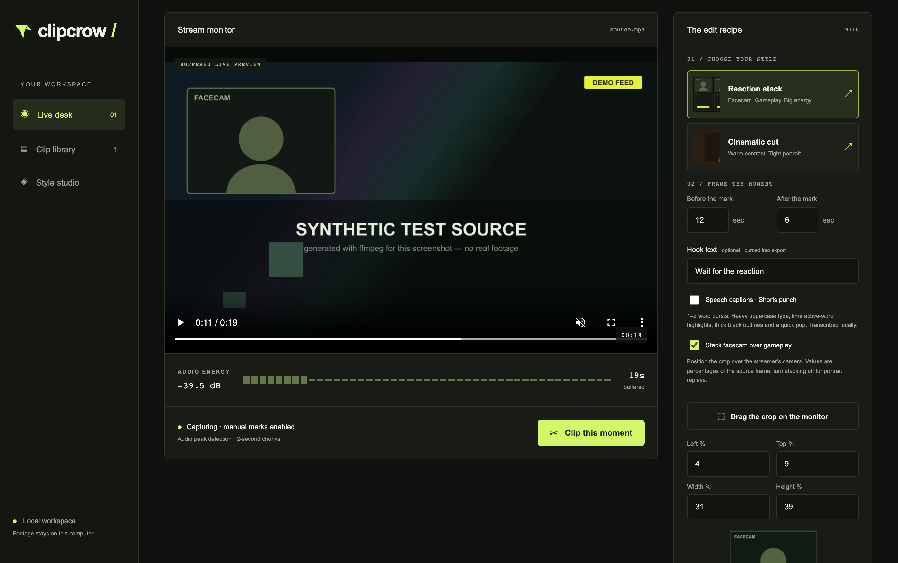
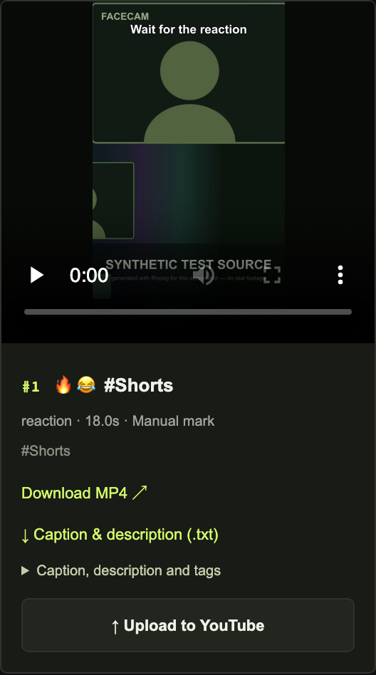

# Clipcrow

A local live-stream clipping desk. Point it at a YouTube Live stream, mark the moments worth keeping
(or let it catch audio spikes by itself), and it exports vertical 540 x 960 MP4s with burned-in
Shorts captions. It then writes a title, description and hashtags for each clip from the stream's own
listing and that clip's transcript, and a Chrome extension can type all of it into the YouTube Studio
upload form for you.



<sub>Captured against a synthetic test source generated with ffmpeg — the repo ships no real
footage.</sub>

Everything runs on your own machine. No account is needed to clip; nothing is uploaded unless you
set up YouTube yourself, and no video or audio leaves the computer during capture or transcription.

This is a working early build, not a finished product. [What is implemented](#what-is-implemented)
lists honestly what it does and does not do — read it before expecting an autonomous editor.

## What you need

| Tool | Needed for | Getting it |
|---|---|---|
| **Node.js 22+** | everything | [nodejs.org](https://nodejs.org/) or `nvm install 22` |
| **FFmpeg** | everything | `brew install ffmpeg`, or `sudo apt install ffmpeg` |
| **Python 3.11+** | for YouTube links and captions | usually already installed |
| **~2GB disk** | for the Python packages and clips | exports run about 9MB each |

macOS or Linux. On Windows use WSL2 — the paths and `setup.sh` assume a Unix shell.

## Install

```sh
git clone https://github.com/aimhackeritesh/clipcrow.git
cd clipcrow
./setup.sh
```

`setup.sh` installs the Node packages and builds a `.venv` holding **yt-dlp** (which opens YouTube
links) and **faster-whisper** (which transcribes clips for captions). It finishes by running the
setup check. FFmpeg is the one thing it will not install for you, because that belongs to your
package manager.

Check the setup any time, without starting anything:

```sh
npm run doctor
```

It names anything missing and the exact command that fixes it. yt-dlp and faster-whisper are
reported as optional on purpose: without them you can still clip from direct HLS/RTMP/SRT URLs and
local files, just not from YouTube links or with speech captions.

## First run

```sh
npm start
```

Open **http://127.0.0.1:4317**. The server binds to this computer only.

Paste a YouTube Live watch URL into the monitor and press Connect. Then either press **Clip this
moment** when something happens, or switch on **Auto-clip audio peaks** and leave it running.
Finished clips appear in the queue with a preview, a download and a generated caption.

If the port is taken, `PORT=4318 npm start`. Every setting is an environment variable and they are
all listed in [`.env.example`](.env.example).

## Uploading to YouTube (optional)

There are two routes, and for most people the second is the easier one.

### Route 1: the Data API, with your own OAuth client

Uploading from inside the desk needs your own Google OAuth client; Clipcrow ships without one.

1. At [console.cloud.google.com](https://console.cloud.google.com/) create a project and enable **YouTube Data API v3**.
2. Configure the OAuth consent screen as **External**, and add your own Google account under **Test users**.
3. Create an OAuth client of type **Desktop app**, download the JSON, and save it in this folder as `youtube-credentials.json` (it is gitignored). Alternatively export `YT_CLIENT_ID` and `YT_CLIENT_SECRET`.
4. Restart the app, then press **Connect YouTube Studio** and complete the Google sign-in in the tab that opens. The refresh token is written to `data/youtube-auth.json` and never leaves this computer.

Two limits come from YouTube, not from this app. Until the Google Cloud project passes YouTube's API Services audit, **every uploaded video is forced to private** regardless of the visibility you choose. The default API quota is 10,000 units a day and an upload costs about 1,600, so roughly **six uploads a day**. A consent screen left in Testing also expires its refresh token after seven days, so you reconnect weekly.

If that sounds like more trouble than it is worth, use the extension below instead. It needs no
Google Cloud project, has no quota and no private-until-audited restriction, because it is you
uploading in your own browser.

### Route 2: the Chrome extension

`extension/` is an unpacked MV3 extension that removes the typing from a manual upload. It does not
upload anything itself and never presses Publish.

1. Start Clipcrow, so the extension has something to read.
2. In Chrome open `chrome://extensions`, switch on **Developer mode**, choose **Load unpacked** and
   select the `extension/` folder.
3. Click the Clipcrow icon. The popup lists finished clips by number, title and spoken line. Tick
   the ones to upload and press **Stage N clips**. They queue oldest number first.
4. Open `studio.youtube.com` and press **Fill from Clipcrow** on the bar at the bottom of the page.
   It opens Create -> Upload videos itself, attaches the clip and types the caption. The bar shows
   the queue position, for example `3 / 7`.
5. Review, choose visibility and press Publish yourself. Then press **Next** on the bar and press
   Fill again for the following clip.

It attaches the MP4, types the title and description from the clip's `caption.txt`, and selects
*not made for kids*. Visibility, the final read-through and Publish are left to you on every clip in
the queue: a batch is uploaded one at a time on purpose, because nothing should reach the channel
without being looked at.

The server allows cross-origin **reads** from `https://studio.youtube.com` only, so the extension can
fetch the clip and its caption. Writes from that origin are refused, and no other site is granted
anything.

Studio is a Polymer app whose internals are not a public interface. The content script searches
shadow roots for the file input, the title and description boxes and the audience radio, with
fallback selectors, and it reports in the bar when a field cannot be found rather than guessing. A
YouTube redesign will break it; the fix is new selectors in `extension/content.js`.

## Hosting it somewhere other than this computer

Clipcrow cannot run on Vercel, Netlify or any serverless host. It keeps an FFmpeg process alive for
the length of a stream, writes a growing buffer to disk and holds the session in memory. Those hosts
give none of the three. It needs a container with a persistent volume: Fly.io, Railway, Render or a
plain VM all work from the `Dockerfile` here.

**The server refuses to start on a public interface without `CLIPCROW_PASSWORD`.** Anyone who reaches
the desk can spend your upload quota and publish to the connected channel, so the gate is not
optional. Sessions are signed cookies; the captures and the OAuth hand-off are behind the gate too.

```sh
fly launch --no-deploy
fly volumes create clipcrow_data --size 20 --region bom
fly secrets set CLIPCROW_PASSWORD='choose-a-long-one'
fly secrets set YT_CLIENT_ID='...' YT_CLIENT_SECRET='...'
fly deploy
```

Railway, Render or a VM take the same image: mount a disk at `/data` and set `HOST=0.0.0.0`,
`DATA_DIR=/data` and the same secrets. `PORT` is read from the environment.

Three things change once it is hosted:

- **The OAuth client must be of type Web application, not Desktop.** Google only allows loopback
  redirects for Desktop clients. Register `https://<your-app>/oauth/callback` as an authorised
  redirect URI on a Web application client, and set `YT_CLIENT_ID` / `YT_CLIENT_SECRET` from it.
- **Size the machine for continuous transcoding.** `fly.toml` asks for 2 shared CPUs and 4GB because
  one H.264 transcode runs for the whole stream and transcription runs on the CPU beside it. Less
  than that and the buffer falls behind the stream. Never enable machine auto-stop: it would be
  stopped mid-capture.
- **Watch the volume.** Exports are kept forever; roughly 9MB per clip, so 20GB holds a couple of
  thousand. Clear old clips from `data/` while the app is stopped.

## Use

1. Paste a public YouTube Live watch URL, direct HLS/RTMP/SRT media URL, or absolute local video path. Local files play into the buffer at normal speed, which is a good way to try the desk without a live stream. The two reference replay buttons are empty until you point `CLIPCROW_DEMO_REACTION` and `CLIPCROW_DEMO_CINEMATIC` at videos of your own.
2. Choose Reaction stack or Cinematic cut. Reaction stacking is on by default. Click **Drag the crop on the monitor** and drag the facecam region straight onto the stream preview — drag an area to draw it, drag inside it to move it, pull a handle to resize it, or focus it and use the arrow keys (hold Shift to resize, Alt for single-percent steps). The Left / Top / Width / Height percentages stay in sync and can still be typed in. A crop you drag is applied to the running capture on release, and the readout confirms it; if the capture has been stopped or reconnected since you started drawing, it is left unapplied and says so, because the box was drawn against frames from the previous stream. Typed values and every other setting still wait for **Apply recipe**. The preview shows the crop before export. Set the seconds to retain before and after each mark.
3. Enable automatic audio-peak clipping and Apply recipe, or click Clip this moment. A mark snapshots the current recipe. The clip waits for its ending, then enters a serial export queue.
4. Preview and download the vertical MP4 from Your clip queue. Exported clips and their metadata survive a restart.
5. Each finished clip carries a generated **YouTube caption**: open it on the clip card to read the title, description and hashtags before publishing. Press **Upload to YouTube** on a clip, or switch on **Auto-upload new clips** to send every finished clip. Visibility defaults to private.



Each finished clip arrives numbered, with the hook burned in, the MP4 and its `caption.txt` ready to
download, and the generated title, description and hashtags behind the disclosure.

The YouTube resolver uses yt-dlp and its JavaScript challenge support. Some videos require login, cookies, or platform changes; the current UI surfaces the resolver error and does not read browser cookies. Combined streams and separate video/audio HLS tracks are supported. Capture and MP4 export with audio were verified using the supplied YouTube Live link `gHYx_XYl0Tg`. This build does not yet implement reconnects or refresh expired media URLs.

## What is implemented

- FFmpeg HLS ingestion with two-second keyframed segments and a rolling two-minute on-disk buffer.
- Browser stream preview using bundled hls.js, with a still-frame fallback.
- Manual pre/post-roll clipping; segment copies isolate queued exports from buffer pruning.
- Automatic detection of a >3 dB audio-energy jump above a configurable threshold, with a 25-second cooldown. This measures segment mean volume, not semantic relevance or virality.
- Reaction preset: portrait center crop, adjustable facecam crop stacked over gameplay (42% / 58%), with an export layout preview, bold static hook text.
- YouTube Studio connection over OAuth (loopback redirect, `youtube.upload` and `youtube.readonly`), resumable upload of a finished clip, per-clip upload or auto-upload, and a visibility choice of private, unlisted or public.
- Generated upload captions: the title takes the clip's own spoken hook (or the burned-in hook text) and the stream's title; the description follows the captions in spoken order and credits the source stream; hashtags and video tags are ranked from the stream's own YouTube tags against what this clip says. Profanity in a transcript is masked in the title and description, though never in the burned-in captions. A trailing date or time stamp is dropped from the stream title before it is shortened, and the description line is chosen by shape — prose about the stream, never a section header, link dump, handle list or legal notice — falling back to the stream title when a description carries nothing else. The caption is rebuilt from the clip's stored transcript at upload time, so a clip exported by an older build still uploads with the current caption. There is no language model involved: the same clip always produces the same caption.
- Hashtags are the stream's own tags, not live platform trends. YouTube publishes no trending-hashtag API, and nothing here scrapes one.
- Manual facecam crop drawn directly on the stream monitor: draw, move, resize by handle, or nudge with the keyboard. The region is read in source-frame percentages, clamped to the ranges the server validates, and mapped through the letterboxed preview, so the box lands on the same pixels the export crops. It is a manual control — there is no face detection. Dragged crops auto-apply to the capture they were drawn on, identified by the capture session; a reconnect to the same URL counts as a new capture and is not auto-applied. Crops are not remembered between captures.
- Cinematic preset: portrait crop, warmer contrast, reduced saturation, light sharpening, serif static hook text.
- H.264/AAC MP4 export at 540 × 960; input audio preserved with limiting. No new music is added.
- Responsive interface, clip previews/downloads, capture activity and visible errors.

## Reference interpretation

The streamer reference shows a facecam above gameplay, large outlined speech captions and a top hook. The Bond reference shows tight subject framing, warm grading and editorial typography. The presets approximate those compositional and text choices. Local faster-whisper base transcription now generates timed 1–2 word bursts, burned into exports in heavy uppercase Impact type, white with lime active-word highlights, a thick black outline, slight tilt, and a 75ms entry pop around 60% of frame height. Speech captions are enabled by default. Model weights download on first use; audio stays local. Review recognition accuracy before sharing. Subject tracking, scene selection, music beat detection, speed ramps and automatic montage construction are **not implemented**. Existing captions in the replay footage are already part of that footage.

This is near-real-time: source/platform delay + up to one segment + configured post-roll + transcription and export time. It is not zero-latency. Stop capture before changing sources. Live sessions are not resumed after restarting the app. Buffer files remaining from past sessions are retained in `data/`; exports are also stored there. Avoid deleting data while the app is running. Long-term storage management and multi-user hosting are outside this build. Uploading is single-account: one connected channel at a time, with the token in `data/`. The stream listing is read once when you connect a source, so captions are only generated for clips cut from a stream connected after this feature was added; older clips have no caption and upload under their own title.

## When something breaks

Run `npm run doctor` first — most of these it will spot for you.

**"YouTube resolver missing"** — yt-dlp is not installed. Run `./setup.sh`.

**"YouTube could not be opened"** — usually yt-dlp being out of date, which happens often because
YouTube keeps changing. Update it and try again:

```sh
.venv/bin/pip install -U yt-dlp
```

Some streams also need a login or cookies, which this build does not read. Members-only and
age-restricted streams will not open.

**No captions on the export** — the first clip is slow because faster-whisper downloads its model
weights (about 150MB) on first use; later clips are quicker. If they never appear, check
`npm run doctor` for faster-whisper, or untick **Speech captions** to export without them. A clip
with no speech in it gets no captions, which is working as intended.

**`EADDRINUSE` on start** — something already holds the port, often an older copy of Clipcrow.
Use `PORT=4318 npm start`, or stop the other one with `lsof -ti:4317 | xargs kill`.

**`npm install` fails building sharp** — you are probably on Node older than 22. Check with
`node --version`.

**The extension popup says Clipcrow is not answering** — the desk has to be running for the
extension to read clips from it. Start it with `npm start` and reopen the popup.

**Every auto-clip is noise** — audio-peak detection measures loudness, not interest. Raise the
trigger level (toward 0 dB) to catch less, and expect to throw a lot away. It has no idea what is
funny.

**The extension stops filling fields** — YouTube redesigned Studio. The selectors live in
`extension/content.js`; there is nothing stable to depend on there, as explained above.

## Checks

```sh
npm test
# With server running and Google Chrome installed:
node scripts/verify.mjs
```

The integration check replays the cinematic reference in real time, waits for an audio-triggered MP4, stops capture, checks browser errors and mobile overflow, and saves screenshots into `data/`. Manual reaction export was also verified as 540 × 960 H.264/AAC, with a four-second duration.

## Design

Charcoal editing desk, lime actions, system sans type, monospace telemetry; 4/8/12/16/24/32/40 spacing, 5px controls and 8px panels. The monitor and mark action take priority over settings.

## Implementation references

- [FFmpeg segment and HLS documentation](https://ffmpeg.org/ffmpeg-formats.html)
- [yt-dlp setup and YouTube support](https://github.com/yt-dlp/yt-dlp)

## License

MIT — see [LICENSE](LICENSE). It comes with no warranty: you are responsible for what you upload and
for respecting the rights of whatever you clip.
